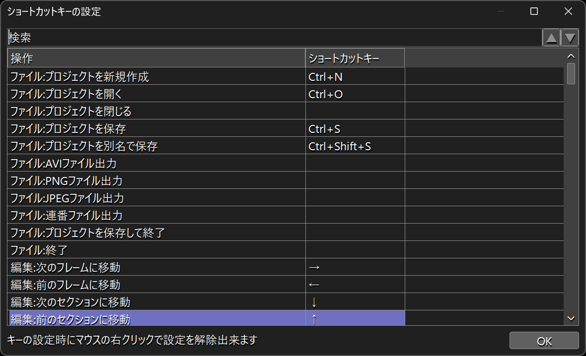

# 🐍AviUtl2 ダイアログサイズ変更MOD

* aviutl2のダイアログをサイズ変更可能にするMODです。
* aviutl2の入力プラグインの形式になっていますが、実際には見た目を変えるタイプのMODです。

> [!WARNING]
> * aviutl2のバージョンによってはダイアログのレイアウトが崩れる場合があります。

## 🚀インストール

* `プラグインフォルダ`に以下のファイルを入れてください。
	* `al2` ✏️フォルダ
		* `al2_dialog_resizer.aui2` ✏️入力プラグインファイル
		* `al2_dialog_resizer` ✏️フォルダ
			* `assets` ✏️フォルダ(ここにプリセットの初期値が入っています)
				* `dialog_design.tsv` ✏️ダイアログのデザイン(サイズなど)を指定できるファイル

## 🔥アンインストール

* `プラグインフォルダ`から以下のファイルを削除してください。
	* `al2` ✏️フォルダ
		* `al2_dialog_resizer.aui2` ✏️このファイルを削除
		* `al2_dialog_resizer` ✏️このフォルダを削除

## 💡使い方

1. aviutl2でダイアログを表示します。
1. 自動的にサイズ変更可能枠と最大化ボタンが追加され、リサイズできるようになります。
---
* **※ただし、`dialog_design.tsv`に記述されているダイアログだけが対象です。**

### 🏷️tsvファイルをカスタマイズする

1. aviutl2を終了すると`プラグインフォルダ\al2\al2_dialog_resizer\config`内にtsvファイルが作成されます。
1. これをテキストエディタで編集してください。**※文字コードはutf-8です。**

### 🏷️設定を初期化する

1. aviutl2を起動していない状態で`プラグインフォルダ\al2\al2_dialog_resizer\config`を削除してください。

## 🔧dialog_design.tsv

* `ダイアログ名` ✏️各ダイアログのタイトル名を指定します。
	* 先頭に`//`を付けると無効化(コメントアウト)できます。
* `幅`
* `高さ` ✏️ダイアログの初期サイズを指定します。
	* `-1`を指定するとデフォルトのサイズのままになります。
* `水平閾値`
* `垂直閾値` ✏️アラインの閾値です。
	* コントロール四隅の各座標が閾値より小さい場合は左上が原点になります。
	* コントロール四隅の各座標が閾値より大きい場合は右下が原点になります。
	* `-1`を指定するとダイアログの中心座標が閾値になります。
	* 全ての座標を左上原点にする場合は`10000`のような大きな数値を指定します。
	* 全ての座標を右下原点にする場合は`0`のような小さな数値を指定します。

## 🔧設定項目

* 現時点では設定できる項目はありません。

## 🔖更新履歴

* 🔖r1 2026年07月08日
	* 🎉初版
